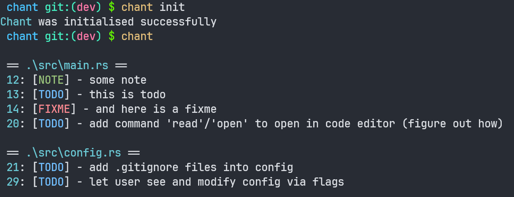

# chant

## About
Chant is a little cli tool for managing microtasks within the project. It keep tracks of comments and sores tasks and their statuses

## Usage

### Example



### Commands

Main commands:
- `chant init` to initialize chant. It creates `.chant/` directory and adds it to the `.gitignore` file
- `chant [list]` - display all found comments
- `chant scan` - forced scan without hash checking
- `chant dismiss` - removes `.chant/` dir and removes it from `.gitignore` file
- `chant stave` - tracks (lockaly) information about your projects. Use `-t` flag to add a new one, or `-r` to remove. `chant init` automatically adds project to the stave

You can also run Chant without initializatoin with `chant --hollow` command. This will not create `.chant/` directory, so not all functions will be available

You can run `--help` with any command for more informaton

### Task

Tasks were appeared in v0.2.0. Essentially, it's a simple kanban board inside Chant.
In verion 0.4.3 task structure was changed (from simple to-do list to a kanban board). You should run `chant task migrate` to save all of your old tasks!

List of commands:
- `chant task` - list of tasks
- `chant task [add|new] <message> [-i|--in-progress] [-d|--done]` - add new task with message with specified status (backlog by default)
- `chant task edit <id>` - change task message
- `chant task backlog <id>` - set task status to "Backlog"
- `chant task [in-progress|working] <id>` - set task status to "InProgress"
- `chant task done <id>` - set task status to "Done"
- `chant task remove <id>` remove one task from storage

### Config

Now in `~/.chant/config.toml` chant store:
1. [scanner]:
    1. list of supported files (file extentions)
    2. list of ignored entries

You can modify both of this, but be careful, chant **doesn't** supports languages, where comments are not started with `//`. I'll add this later

### Useful flags
- `chant --hollow` - use chant without initialization
- `chant [-t|--todo] [-n|--note] [-f|--fixme]` - show specific comments (also works with `--hollow` flag)
- `chant [list] [-b|--both]` - show both comments and tasks
- `chant task remove --done` - remove every complete task
- `chant task remove --all` - remove all tasks

## Installation

```bash
git clone https://github.com/EnotInc/chant.git
cd chant
cargo install --path . # --force
```
